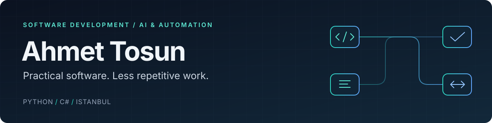

  

  
  
  

### About me

I'm Ahmet, a developer based in Istanbul, Türkiye. I build **practical automation tools and creative web experiences** with Python, C#, and JavaScript.

My work spans document workflows, desktop applications, AI integrations, and interactive browser projects. I enjoy turning an idea into something people can use or explore.

### Tools I work with

**Languages & applications**

  
  
  
  
  
  

**Databases**

  
  
  
  

**AI & integrations**

  
  
  
  
  
  
  
  

**Automation & development**

  
  
  
  
  
  
  

### Selected projects

<table>
  <tr>
    <td width="50%" valign="top">
      <h3><a href="https://github.com/ahmetsn34/WellcomeISG-Automation">Wellcome ISG Automation</a></h3>
      
A desktop automation tool for personnel registration and occupational health and safety document workflows on the Wellcome portal.

      
Python · CustomTkinter · Selenium · pandas

    </td>
    <td width="50%" valign="top">
      <h3><a href="https://github.com/ahmetsn34/Seafort_Frontend">Seafort Frontend</a></h3>
      
      
A responsive, ten-page maritime services website interface with navigation, service pages, and demo forms.

      
HTML · CSS · JavaScript · Static site checks

    </td>
  </tr>
  <tr>
    <td width="50%" valign="top">
      <h3><a href="https://github.com/ahmetsn34/BirthdayAppForHer">BirthdayAppForHer</a></h3>
      
      
A first-person WebGL garden with an interactive cake, candle wishes, and synthesized music. A personal creative project with a neutral portfolio demo.

      
<a href="https://ahmetsn34.github.io/BirthdayAppForHer/portfolio.html?demo=1">Explore the demo →</a>

      
JavaScript · Three.js · Web Audio · Node.js tests

    </td>
    <td width="50%" valign="top">
      <h3><a href="https://github.com/ahmetsn34/GaleriOtomasyon">Galeri Otomasyon</a></h3>
      
A university source archive for vehicle, customer, personnel, and payment management. Setup notes document missing source files and database prerequisites.

      
C# · Windows Forms · Entity Framework · SQL Server

    </td>
  </tr>
</table>

Also experimenting with [PixelShooter](https://github.com/ahmetsn34/PixelShooter), a Python/Pygame FPS with raycasting and pathfinding bots.

### On hold

[Purchase AI](https://github.com/ahmetsn34/Purchase_AI) is an **unfinished procurement prototype**. Development is paused; I plan to return to it later.

### Let's connect

Interested in automation, AI tools, or creative web projects? Reach me on [LinkedIn](https://www.linkedin.com/in/ahmet-t-171123180/) or by [email](mailto:ahmettosun.dev@gmail.com).

Outside of code: PC hardware, JDM cars, and the occasional game experiment.

